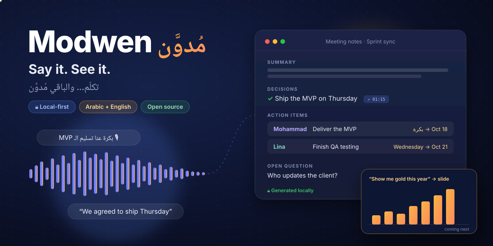

<p align="center">
  
</p>

<p align="center">
  <a href="LICENSE"></a>
  
  
  
</p>

<p align="center">
  <a href="docs/install.md"><b>Install</b></a> ·
  <a href="https://modwen.rtima.org/"><b>Website</b></a> ·
  <a href="docs/system-design.md"><b>Design</b></a> ·
  <a href="CONTRIBUTING.md"><b>Contribute</b></a>
</p>

# Modwen · مُدوَّن

**Say it. See it.** Modwen turns speech into something you can use, and it runs entirely on your own computer.

*مُدوَّن* means "written down" in Arabic.

- **Today: meeting notes.** Press Start in Google Meet, the Teams desktop app, or an in-person meeting. You get live captions while you talk.
  - Press Stop, and Whisper transcribes Arabic, English and mixed speech (code-switching, including Gulf, Levantine and Egyptian dialects).
  - A local LLM (Qwen) writes the summary, decisions, action items with owners and deadlines, and open questions.
  - A **"Notes ready"** notification tells you when they're done.
- **Next: voice to artifacts.** Say *"show me a chart of the gold price this year"* and a slide appears, live. See the [roadmap](#roadmap).

**Private by design.** Audio and transcripts never leave your machine:
- The AI model runs locally.
- Non-localhost endpoints are refused in code.
- Recordings are encrypted with a separate key per meeting.

> Status: **alpha (0.2)**. Verified on macOS (Apple Silicon). Windows support is written but not yet tested.

## Install (macOS and Windows)

1. Download `modwen-<version>.zip` from Releases and unzip it.
2. Double-click **`Modwen.command`** (macOS; the first time, right-click → Open) or **`Modwen.bat`** (Windows).
3. The setup wizard opens in your browser:
   - It tests your audio and picks models for your hardware.
   - It downloads the speech models.
   - For the AI model you can either **download Qwen** (Modwen runs it for you) or **connect your own local server** (Ollama, LM Studio, llama.cpp: any `localhost` URL).

Full guide: [docs/install.md](docs/install.md).

### From source (developers)

```bash
git clone <this repo> modwen && cd modwen
uv sync --extra stt --extra desktop --extra mac        # Windows: --extra windows (and --extra cuda with NVIDIA)
(cd ui && npm install && npm run build)                # web UI
bash modwen/native/macos/build.sh                      # macOS system-audio helper
uv run modwen serve                                    # opens the app; the setup wizard runs on first start
uv run pytest                                          # tests (no network or models needed)
bash scripts/make_release.sh                           # builds release/modwen-<version>.zip
```

## Try it without a meeting

```bash
bash samples/make_samples.sh                                    # macOS: bilingual sample audio
uv run modwen process samples/generated/bilingual_meeting.wav   # transcript + notes in the terminal
uv run modwen simulate --system samples/generated/bilingual_meeting.wav \
                       --mic samples/generated/mic_track.wav --speed 1   # live captions + notes
```

## How it works

```
mic + system audio ─► encrypted 30 s chunks ─► live captions (fast Whisper)
                                   │
                         Stop ─► VAD windows ─► Whisper large-v3 (per-window language: ar/en/mixed)
                                   │
                         speakers (You / Person 1..N, echo dropped) ─► local LLM (OpenAI-compatible, localhost)
                                   │
                         notes JSON (every item cites transcript lines) ─► review UI ─► Copy / Export .md
```

Any OpenAI-compatible **local** server works: llama.cpp, Ollama, LM Studio or vLLM. Switching is a one-line change in `config.yaml`.

## Docs

| | |
|---|---|
| [docs/install.md](docs/install.md) | Install and first run (for users) |
| [docs/testing-guide.md](docs/testing-guide.md) | Step-by-step testing on macOS and Windows |
| [docs/local-llm-setup.md](docs/local-llm-setup.md) | Running Qwen locally on localhost:8080 |
| [docs/system-design.md](docs/system-design.md) | Architecture, Arabic/English strategy, privacy, data model |
| [docs/ui-design.md](docs/ui-design.md) · [docs/mockups/index.html](docs/mockups/index.html) · [docs/mockup-coverage.md](docs/mockup-coverage.md) | UI design, clickable mockups, and what's built |

## Roadmap

- **0.2 (now):** meeting capture, live captions, Arabic/English transcription, local LLM notes, review UI.
- **Next:** voice → live slides and charts (an LLM tool-calling layer; public data fetched only on explicit request, never meeting audio), a desktop app (Tauri) with installers, voice enrollment for speaker names.
- **Later:** email of approved notes, calendar integration, search across meetings.

## Contributing

Contributions are welcome. Arabic dialect test recordings and prompt improvements are especially valuable. See [CONTRIBUTING.md](CONTRIBUTING.md).

## License

[Apache-2.0](LICENSE)
