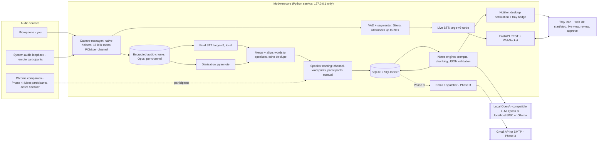
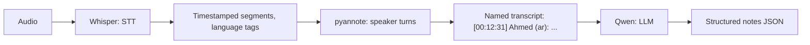
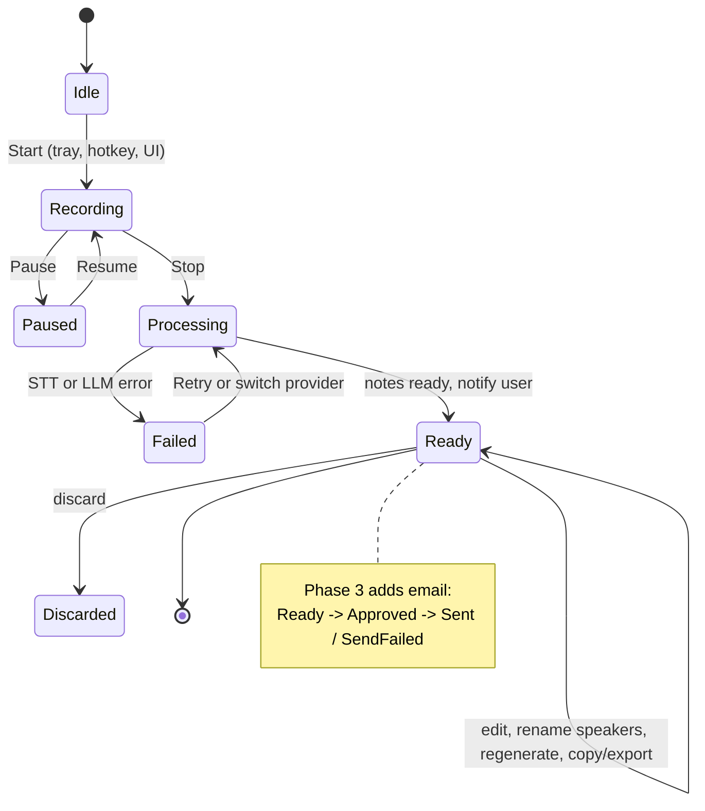

# Modwen: System Design (Phase 1)

Date: 2026-10-16. Status: draft for review, no code yet. UI screens: [ui-design.md](ui-design.md).

Modwen is a local-first meeting note-taker that you start when you need it. One click (a tray icon or a hotkey) records your mic and your system audio, and a live transcript runs while you talk. When you stop, a local pipeline transcribes the meeting accurately and works out who said what. A pluggable LLM then writes the notes, and Modwen notifies you as soon as they're ready. Emailing the notes comes in a later phase.

The pipeline has two separate AI stages:

- **Speech-to-text (Whisper) turns audio into timestamped text.**
- **The LLM (Qwen) never hears audio.** It only reads the finished transcript, with speaker names, and writes the notes.

---

## 0. Key decisions

| Area | Decision | Why |
|---|---|---|
| Form factor | A local background service with a tray icon and a web UI on `127.0.0.1`. An optional Chrome companion comes later. | It is the only option that captures Meet, Zoom and Teams desktop apps, plus in-person meetings, with one click. |
| Audio | Two separate streams: your mic and system audio | You get "me vs. everyone else" speaker labels for free, and it handles echo better. |
| Speech-to-text | Two passes. A fast live pass (Whisper large-v3-turbo) feeds the live view. An accurate final pass (Whisper large-v3) runs after you press Stop. | The notes come from the final pass, so accuracy matters more than speed. |
| Arabic/English | Language is detected per utterance, limited to {ar, en}. A bilingual prompt and a glossary help. Everything runs locally. | Mixed Arabic/English in the same sentence is Whisper's weakest point. |
| Privacy | **Local only, always.** No meeting audio or text goes to any cloud service. Cloud providers are blocked in code. | Your policy (§0.1). |
| Hardware | Unknown, so Modwen **detects the machine and picks models automatically** (§6.1) | It has to work well on both the Windows PC and the Mac without tuning. |
| Speakers | pyannote.audio, voice enrollment and manual relabeling | It is the most accurate open-source option, and you always get the final say. |
| LLM | Any OpenAI-compatible endpoint. The default is Qwen3 on `localhost:8080` via llama.cpp. Only local endpoints (Ollama, LM Studio, vLLM, llama.cpp) are allowed by policy. | Switching provider is a config edit, not a code change. |
| Notes ready | **MVP:** a desktop notification and a tray badge as soon as the LLM finishes, plus "Copy as Markdown" and "Export .md" buttons. **Phase 3:** email via the Gmail API (SMTP fallback), approved by a person first. | The pipeline gets proven first; email is added on top later without changing it. |
| Platforms | **Windows 10/11 and macOS** from the MVP. Google Meet (in the browser) and the Microsoft Teams desktop app are the main targets. | Capturing system audio covers both without any Meet or Teams integration. |
| Storage | SQLite encrypted with SQLCipher, encrypted audio files, keys in the OS keychain | Everything is local and encrypted, with few moving parts. |
| Stack | A Python 3.12 core (FastAPI), a React UI and small native audio-capture helpers. A Tauri app shell comes in v1. | Python has the audio and machine-learning libraries. |

### 0.1 Confirmed requirements (your answers, 2026-10-16)

| Topic | Answer | Effect on the design |
|---|---|---|
| Email | Optional; later phase | Email moves to Phase 3. In the MVP, Modwen notifies you when the LLM finishes (§3, §11). |
| Meeting languages | Mixed Arabic + English, sometimes English only, sometimes Arabic only | Language is detected per utterance, so all three work automatically. The Start dialog can also force English only or Arabic only when you know in advance (§4). |
| Operating systems | Windows and macOS | Both are in the MVP: WASAPI loopback on Windows, Core Audio taps on macOS (§1). |
| Platforms | Google Meet and the Teams desktop app | Captured through system audio. The Chrome companion (Phase 4) only helps with Meet. |
| Default summary language | English | `notes.summary_language: en`. Arabic or both stay one click away in review. |
| Live transcript | Yes, keep it simple | In the MVP: a fast turbo pass with "You / Others" labels, no names, never sent to the LLM (§3). |
| Meeting length | 2 hours, sometimes more | The design assumes 3+ hours: crash-safe chunked audio, map-reduce notes, longer processing (§3, §7, §12). |
| Calendar | Gregorian only | Deadlines resolve to Gregorian dates only (§7). |
| Cloud | **No.** Meeting audio and text never go to a cloud service. | `privacy.allow_cloud` is fixed to `false`. Cloud speech-to-text, cloud LLM fallback and "Arabic polish" are removed from the plan. The OpenAI-compatible interface stays, but only loopback URLs pass the egress gate (§7, §10). |
| Hardware | Not sure | Modwen detects RAM, GPU and VRAM itself and picks the Whisper and Qwen sizes (§6.1). It also states minimum and recommended specs. |
| Timezone | The user's own timezone | Deadlines resolve in the OS timezone of the machine running Modwen (`notes.timezone: system`). |

---

## 1. Form factor

**Recommendation: a hybrid with a local core.** A Python service runs in the background with a tray icon and serves a web UI on localhost. In Phase 4 an optional Chrome extension can be added as a companion for Google Meet.

| Criterion | Chrome extension | Desktop app | Local service + tray/web UI | **Hybrid (recommended)** |
|---|---|---|---|---|
| One-click start/stop | Yes | Yes | Yes (tray or hotkey) | Yes |
| Meet/Zoom/Teams in a browser | Yes | Yes | Yes | Yes |
| Zoom/Teams **desktop apps** (you use Teams desktop) | **No** | Yes | Yes | Yes |
| In-person (mic only) | Awkward | Yes | Yes | Yes |
| Participant names | Yes, for Meet (reads the page) | No | No | Yes, via the companion |
| Runs Whisper/pyannote locally | No (needs a backend anyway) | Yes | Yes | Yes |
| Permissions | tabCapture, with a user gesture on each tab | Mic + system audio (macOS prompt) | Same as desktop | Same + extension |
| Cross-platform | Anywhere Chrome runs | Native work per OS | Small capture helper per OS, shared UI | Same |
| Build effort | Low, but still needs a backend | High | **Medium** | Medium, then a little more for the extension |

Reasons:
- A Chrome extension alone fails the requirements because it can't hear desktop Zoom or Teams, or an in-person meeting. It would also still need a local backend for speech-to-text.
- The local service is effectively a desktop app with a web front end:
  - The UI is cross-platform.
  - It can later be wrapped in **Tauri** (installer, auto-start, signed app, global hotkey) without a rewrite.
- The Chrome companion is worth adding later for two reasons:
  - It reads the Meet participant list, which gives the names to choose from.
  - It records active-speaker highlights, which make speaker detection on Meet much more accurate.

  Scraping the Meet page is brittle, so the companion is an extra, never a requirement.

**Audio capture by OS**

| OS | Mic | System audio | Permission |
|---|---|---|---|
| macOS 14.2+ (you're on 14.4) | PortAudio (`sounddevice`) | **Core Audio process taps**, through a small Swift helper | Mic + "System Audio Recording" prompt |
| macOS 13 | same | ScreenCaptureKit audio, through the Swift helper | Screen Recording permission (more intrusive) |
| Windows 10/11 | PortAudio | WASAPI loopback (`pyaudiowpatch`) | Mic privacy toggle only |
| Linux | PortAudio | PipeWire/PulseAudio monitor source | None |

Known limits:
- **Bluetooth headsets.** Using a Bluetooth headset's mic drops the audio to low-quality HFP, which hurts accuracy. Use a wired or USB headset, or the built-in mic.
- **Echo.** Without headphones, the mic also picks up the other participants. Modwen de-duplicates this (see §12), but headphones are better.

---

## 2. Architecture



### Component breakdown

| Component | Responsibility | Technology |
|---|---|---|
| Capture manager | Start and stop the per-OS capture helpers. Keep the mic and system audio as separate channels. Write encrypted 30-second chunks so audio survives a crash. | Swift helper (macOS), `pyaudiowpatch` (Windows), `soundcard` (Linux), `sounddevice` for the mic |
| VAD + segmenter | Cut speech into short utterances and drop silence, which stops Whisper hallucinating on silence | Silero VAD |
| Live STT | Captions about 2–5 s behind speech, for the live view only. Never sent to the LLM. | faster-whisper / mlx-whisper, large-v3-turbo |
| Final STT | Accurate transcript with word timestamps, run after Stop | faster-whisper (NVIDIA/CPU), mlx-whisper (Apple Silicon) |
| Diarization | "Who spoke when", run on the system-audio channel (and on the mic channel when in person) | pyannote.audio (`speaker-diarization-community-1`) |
| Merge + align | Assign words to speaker turns, put both channels on one timeline, remove echo duplicates | Own code |
| Speaker naming | Map speaker clusters to people (§5) | pyannote embeddings + rules |
| Notes engine | Build prompts, split long transcripts into chunks, call the LLM, validate the JSON, check output language | `openai` SDK, Pydantic, Jinja2 prompt templates |
| Storage | Meetings, transcripts, notes, voiceprints, email log | SQLite + SQLCipher, encrypted files |
| Notifier (MVP) | When the LLM finishes: a desktop notification ("Notes ready: Sprint review"), a tray badge, and a click that opens the review screen. On failure: a "Notes failed, retry" notification. | `desktop-notifier` (Windows toast, macOS Notification Center); Tauri notifications in v1 |
| Email dispatcher (Phase 3) | Render HTML + text and send only after approval | Gmail API, `aiosmtplib` |
| API + UI | Start/stop, live transcript, review editor, recipients, approve | FastAPI + WebSocket, React + Vite |

### How speech-to-text and the LLM fit together



- Whisper and pyannote are **audio models**. Each runs once per meeting.
- Qwen is a **text model** that reads text and writes text.
- You can swap either side independently, for example a different Whisper size or a different local Qwen. Under the local-only policy, both sides always run on your machine.

---

## 3. Data flow: from Start to email sent



1. **Start.** You click the tray icon or press the hotkey (default `Ctrl/Cmd+Shift+B`).
   - The consent prompt appears (§10).
   - A `Meeting` row is created with status `recording`, and the tray icon turns red.
2. **Capture.** The helpers stream 16 kHz mono PCM for each channel.
   - Audio is written to disk as encrypted 30-second Opus chunks.
   - The same audio also goes to the VAD.
3. **Live pass (MVP, kept simple).** VAD utterances go to the turbo model, and the text is pushed to the UI over WebSocket.
   - Labels are "You" (mic) and "Others" (system audio).
   - There is no live diarization and no live naming; real names appear only after processing.
   - Live text is shown only. It's never stored as the final transcript and never sent to the LLM.
   - If the machine falls behind (CPU only), the live view skips ahead and shows "live paused", and recording continues untouched.
4. **Stop.** Status becomes `processing`, and the final pass runs on each channel:
   - Final STT with word timestamps.
   - pyannote on the system-audio channel. The mic channel is labeled "you".
   - Both channels are merged onto one timeline, and echo duplicates are removed.
5. **Speaker naming.** Names are assigned automatically. Speakers that can't be matched stay as "Speaker 2" and so on.
6. **Notes.** The notes engine builds the prompt (§7).
   - Long transcripts are split, processed in chunks, then merged.
   - The output must pass JSON-schema validation and a language check, with up to 2 retries.
   - Status becomes `ready`.
7. **Ping.** As soon as the LLM finishes, a desktop notification says **"Notes ready: Sprint review (2h 05m)"** and the tray badge turns green. Clicking the notification opens the review screen. If generation fails, a "Notes failed, retry" notification appears instead, and the transcript is kept.
8. **Review.** The notes appear beside the transcript. Clicking any item jumps to the transcript lines it came from.
   - You can rename speakers, edit text, regenerate a section, and choose the summary language: **EN (default)**, AR or both.
   - **Copy as Markdown** and **Export .md** let you share the notes by hand until email exists.
9. **Email (Phase 3).** Recipients, approval and sending, as described in §11.
10. **Retention.** A daily job deletes expired audio and transcripts (§10).

Approximate processing time after Stop, for a 60-minute meeting (these are estimates; we'll measure in the Phase 2 bake-off):

| Machine | Final STT (large-v3) | Diarization | LLM notes | Total |
|---|---|---|---|---|
| NVIDIA 12–16 GB GPU | 3–5 min | 1–2 min | 1–2 min (14B) | about 5–9 min |
| Apple Silicon M1–M3, 16–32 GB | 6–12 min (mlx) | 3–6 min | 2–4 min (8B) | about 12–20 min |
| CPU only | 20–40 min (turbo, int8) | 15+ min | 3–8 min (4B or 30B-A3B) | about 40–60 min |

**Your meetings run 2 hours or more,** so double these figures. For example, a 2-hour meeting takes about 10–18 min on a 12–16 GB NVIDIA GPU and about 25–40 min on Apple Silicon. Three things keep long meetings manageable:
- **Transcription starts during the meeting.** Each finished 30-second chunk goes through the final model in the background whenever the GPU or CPU is free, so after Stop only the tail end is left. This is planned for Phase 3; the MVP processes everything after Stop.
- **Notes need several LLM calls.** A 2-hour bilingual transcript is about 30–50k tokens, more than a 16–32k local context, so it's always split into chunks (§7).
- **The notification means you don't wait.** You close the window and get pinged when the notes are done.
- **There is no cloud fallback.** On a slow machine, the only options are a smaller local model or waiting longer. That is why §6.1 picks models per machine.

---

## 4. Multilingual support (Arabic, English and code-switching)

### Strategy

Your meetings come in three kinds: **mixed Arabic + English, English only, or Arabic only.** The default `auto` mode handles all three, because language is decided per utterance:
- An English-only meeting is simply all `en` utterances.
- An Arabic-only meeting is all `ar` utterances.

When you know in advance, the Start dialog lets you pick **English only** or **Arabic only**. That forces the language, which skips detection entirely and removes the risk of a wrong guess. This is a little more accurate and a little faster.

1. **Segment first.** VAD splits speech into utterances of up to 20 s, so language is decided per utterance rather than once for the whole meeting.
2. **Detect language, limited to {ar, en}.** faster-whisper's `detect_language` returns a probability for every language; Modwen keeps only Arabic and English. Whisper often mislabels Egyptian or Gulf Arabic as Persian or Urdu, and limiting the choice fixes that.
3. **Rule for code-switched speech.** If P(ar) ≥ 0.2, transcribe as Arabic **with a bilingual prompt**. Otherwise transcribe as English.
   - Forcing English on mixed speech tends to *translate* the Arabic.
   - Forcing Arabic with a bilingual prompt tends to keep English terms in Latin script.
   - We'll check this rule in the bake-off.
4. **Bilingual prompt and glossary.** The `initial_prompt` shows the style we want and lists names and product terms, for example: `اجتماع الفريق. ناقشنا الـ roadmap والـ sprint planning، و Ahmed هيعمل الـ deployment يوم Thursday.`
5. **Always `task="transcribe"`.** Never translate.
6. **Anti-hallucination settings:**
   - `condition_on_previous_text=False`.
   - Feed speech only, never silence.
   - A blocklist of known Whisper Arabic hallucinations such as `ترجمة نانسي قنقر` and `اشتركوا في القناة`.
7. **Script policy.** Arabic stays in Arabic script and English in Latin script. No transliteration into Latin letters (Arabizi).
8. **Store language on each segment.** Every segment is tagged `language` (ar, en or mixed) and optionally `dialect` (msa, egy, gulf, lev, unknown).
9. **Notes keep the original words.**
   - Each key point, decision and action item has `text` in the summary language and `original_text`, the exact words from the transcript.
   - The summary can be `en`, `ar` or `both`. **The default is `en`**, with a per-meeting override in review.
10. **Rendering.** Every paragraph uses `dir="auto"`, and mixed lines use Unicode bidi isolation, in both the UI and the email.

### Speech-to-text options compared

Ratings are my estimates, **not benchmarks**. Phase 2 starts with a bake-off on 3–5 hours of our own recordings, measuring WER and a code-switching error rate. Prices are approximate list prices; check them before committing.

| Option | Local? | MSA | Egyptian / Gulf | Mixed in one sentence | Latency | Cost | Verdict |
|---|---|---|---|---|---|---|---|
| **Whisper large-v3** (faster-whisper / mlx / whisper.cpp) | Yes | Good | Fair–good / fair | Fair: may pick one language or translate | Batch; about 10–20× real time on a GPU | Free | **Default final pass** |
| Whisper large-v3-turbo | Yes | Good− | Fair | Fair | About 4–6× faster than large-v3 | Free | **Live pass** |
| Arabic fine-tuned Whisper (community models) | Yes | Good | Can be better on one dialect | Often loses English | Same as base | Free | Try in the bake-off only |
| **Speechmatics** | Cloud (on-prem for enterprise) | Very good | Good | **Good** (bilingual Arabic–English mode) | Real-time + batch | About $0.3–1 per audio hour | **Best cloud candidate** |
| **ElevenLabs Scribe** | Cloud | Very good | Good | Good | Batch + real-time | About $0.3–0.5 per hour | Strong cloud candidate |
| OpenAI gpt-4o-transcribe | Cloud | Very good | Good | Good | Batch + streaming | About $0.36 per hour | Good; limited diarization |
| Azure AI Speech | Cloud (+ containers) | Good | Locales ar-EG, ar-SA, ar-AE, … | Weak (switches language per segment, not mid-sentence) | Real-time + batch | About $0.2–1 per hour | Only if you're already on Azure |
| Google Chirp (STT v2) | Cloud | Good | Several locales | Weak–fair | Real-time + batch | About $1 per hour | Not preferred |
| Gemini 2.5 (audio into the LLM) | Cloud | Very good | Good | Good | Batch | Per token | Timestamps unreliable; second opinion only |

**Decision: local Whisper only.** Your policy is that no audio or text ever goes to a cloud service.
- **Final pass:** large-v3. On CPU-only machines, large-v3-turbo.
- **Live pass:** turbo. On CPU-only machines, `small`.
- **Accuracy comes from local levers only:**
  - The bilingual prompt and the glossary.
  - The Start-dialog language choice.
  - Better microphones.
  - Later, fine-tuning Whisper on your own consented recordings (Phase 5).
- The cloud rows above stay only as a reference point for the bake-off. They are not part of the build.

---

## 5. Speaker diarization and naming

**Detection.** pyannote runs on the system-audio channel, and also on the mic channel in in-person mode.
- Pass `min_speakers`/`max_speakers` when the participant count is known.
- Overlapping speech is flagged on each segment (`overlap=true`) rather than guessed.

**Naming.** Modwen tries these sources in order of confidence:

| # | Source | How | Confidence |
|---|---|---|---|
| 1 | Mic channel | Everything on the mic channel is you (`is_self`) | Very high (online meetings) |
| 2 | Voice enrollment | You record about 30 s of a person once, with their consent. Modwen stores an embedding and matches by cosine similarity (threshold set in the bake-off, about 0.7). | High |
| 3 | Participant list | From the calendar invite (v1) or the Meet companion (Phase 4). This narrows the candidate names; with 2 remote people, one is already known. | Medium |
| 4 | LLM suggestion | The LLM spots cues like "thanks, Sara" and offers them as **suggestions only**, shown with a "?" | Low |
| 5 | Manual | Rename in the review UI. Modwen then offers "Remember this voice?", which enrolls the person. | Final |

- Renaming a speaker updates the transcript and substitutes the name in the notes without calling the LLM again.
- Voiceprints are biometric data, so they're encrypted, deletable, and only kept with consent.

---

## 6. Tech stack

| Layer | Choice | Why | Rejected |
|---|---|---|---|
| Core language | Python 3.12, `uv` for environments | It has all the audio and ML libraries | Node (weak ML), Rust (slow to iterate on ML) |
| API | FastAPI + uvicorn, WebSocket for live text | Async, typed, simple | Flask |
| UI | React + TypeScript + Vite, served by the core; screens and wireframes in [ui-design.md](ui-design.md) | Cross-platform, easy RTL, can be reused in Tauri | Native UI per OS |
| Tray / app shell | MVP: `pystray`. v1: **Tauri 2**, with the Python core as a bundled sidecar. | Tauri gives a small installer, tray, hotkey, auto-start and signing | Electron (heavy) |
| macOS capture | Swift CLI helper (Core Audio taps; ScreenCaptureKit fallback) that streams PCM to stdout | The only reliable route to system audio on macOS | BlackHole virtual device (manual setup) |
| Windows/Linux capture | `pyaudiowpatch` (WASAPI loopback), `soundcard` (PipeWire/Pulse) | No helper process needed | n/a |
| VAD | Silero VAD | Accurate and tiny | WebRTC VAD |
| STT | faster-whisper (CUDA/CPU), mlx-whisper (Apple Silicon), behind an `STTProvider` interface | The fastest local option on each platform | WhisperX alignment (handles code-switching badly) |
| Diarization | pyannote.audio 4.x (`speaker-diarization-community-1`) | Best open-source accuracy | NeMo (heavier) |
| LLM client | Official `openai` SDK with a configurable `base_url` | One client works with every provider | Separate SDK per vendor |
| Validation | Pydantic v2 | JSON schema for the LLM output and the config | n/a |
| Storage | SQLite + SQLCipher (`sqlcipher3`), SQLModel, FTS5 search | One encrypted file | Postgres (overkill) |
| Crypto / secrets | `cryptography` (AES-256-GCM), `keyring` (OS keychain) | Uses the OS's own secret stores | Plain-text config |
| Email | `google-api-python-client` (Gmail), `aiosmtplib` | n/a | n/a |
| Config | YAML + `pydantic-settings`, with env var overrides | Readable, validated | n/a |
| Packaging | PyInstaller sidecar inside Tauri | n/a | n/a |

### 6.1 Hardware tiers (auto-detected)

The specs of the Windows PC and the Mac aren't known yet, and there's no cloud fallback. So Modwen detects the machine on first run (and again when the hardware changes) and picks every model itself:
- **Detected:** RAM, GPU vendor and VRAM (`nvidia-smi` / CUDA), Apple Silicon and its unified memory, CPU core count, free disk.
- **Shown as:** a tier in onboarding and in Settings → About.
- **Overrides:** any choice can be changed in `config.yaml`.

| Tier | Machine | Live STT | Final STT | LLM (Qwen3, Q4_K_M) | 2-hour meeting, Stop to "Notes ready" (approx.) |
|---|---|---|---|---|---|
| **A** | Windows + NVIDIA ≥ 12 GB VRAM, 32 GB RAM | turbo (GPU) | large-v3 (GPU, float16) | 14B, 32k context | 10–18 min |
| **B** | Windows + NVIDIA 8 GB VRAM, 16–32 GB RAM | turbo (GPU) | large-v3 (GPU, int8_float16) | 8B, 16k context, run after STT | 15–25 min |
| **C** | Apple Silicon (M1–M4) with 32 GB+ | turbo (mlx) | large-v3 (mlx) | 30B-A3B-Instruct-2507 | 25–40 min |
| **D** | Apple Silicon with 16 GB | turbo (mlx) | large-v3 (mlx) | 8B, 16k context | 30–45 min |
| **E** | CPU only (incl. AMD/Intel GPUs, Intel Macs), 32 GB+ RAM | small (int8) | large-v3-turbo (int8) | 30B-A3B-Instruct-2507 (MoE, fast on CPU) | 45–90 min |
| **F** | CPU only, 16 GB RAM | base (int8) | large-v3-turbo (int8) | 4B-Instruct-2507 | 60–120 min; Arabic summary weak |
| n/a | Under 16 GB RAM | Not supported for 2-hour meetings | | | |

Notes on the tiers:
- **AMD and Intel GPUs on Windows:** faster-whisper (CTranslate2) only accelerates on NVIDIA, so Whisper runs on the CPU. llama.cpp's Vulkan build still uses the GPU for Qwen. Treat these machines as tier E or F for speech-to-text.
- **Intel Macs:** no MLX or Metal acceleration for Whisper, so they're tier E or F.
- **Disk:** about 25 GB free for models (Whisper about 4.6 GB, Qwen 2.5–19 GB, pyannote under 1 GB), plus about 22 MB per recorded hour (2 channels).

**Minimum spec:** 16 GB RAM, a 4-core CPU from 2019 or later, 30 GB free disk, Windows 10 22H2+ or macOS 14.2+.
**Recommended spec:**
- Mac: Apple Silicon with **32 GB**.
- Windows: an NVIDIA RTX GPU with **12 GB+ VRAM** and 32 GB RAM.

**Checking your specs yourself:**
- macOS: Apple menu → About This Mac (Chip, Memory), or `system_profiler SPHardwareDataType | grep -E "Chip|Memory"`.
- Windows: Task Manager → Performance (Memory; GPU → "Dedicated GPU memory"), or `nvidia-smi` if there's an NVIDIA card.
- Modwen ships a `modwen doctor` command that prints the detected tier, the chosen models, and the exact `llama-server` command for that machine.

---

## 7. LLM plugin interface

**Rule: there is exactly one LLM client, and it speaks the OpenAI Chat Completions API.** Every provider is a *profile* in config. Switching provider means changing `llm.active`; no code changes.

| Provider | base_url |
|---|---|
| Qwen via llama.cpp | `http://localhost:8080/v1` |
| Ollama | `http://localhost:11434/v1` (or `:8080`, see §8) |
| LM Studio | `http://localhost:1234/v1` |
| vLLM | `http://localhost:8000/v1` |
| OpenAI | `https://api.openai.com/v1` |
| Anthropic (OpenAI-compatible endpoint) | `https://api.anthropic.com/v1/` |
| Gemini (OpenAI-compatible endpoint) | `https://generativelanguage.googleapis.com/v1beta/openai/` |

### Interfaces (sketch)

```python
class LLMClient(Protocol):
    def complete_json(self, messages: list[Message], schema: type[BaseModel],
                      *, max_tokens: int = 4096) -> BaseModel: ...
    def complete_text(self, messages: list[Message], *, max_tokens: int = 2048) -> str: ...
    def health(self) -> ProviderHealth: ...        # GET {base_url}/models

class STTProvider(Protocol):
    def transcribe(self, track: AudioTrack, opts: STTOptions) -> list[Segment]: ...

class StreamingSTT(Protocol):
    async def stream(self, chunks: AsyncIterator[bytes]) -> AsyncIterator[Segment]: ...

class Diarizer(Protocol):
    def diarize(self, track: AudioTrack, hints: SpeakerHints) -> list[SpeakerTurn]: ...
```

`OpenAICompatibleClient(profile)` implements `LLMClient`. Providers differ in a few ways, and each difference is handled by a **capability flag in the profile**, not by code:

- `structured_output`:
  - `json_schema`: llama.cpp, Ollama, vLLM, OpenAI.
  - `json_object`.
  - `prompt_only`: Anthropic's compatibility endpoint. The schema goes in the prompt, then Pydantic validation and retry.
- `context_window`: drives the chunking decision.
- `extra_body`: provider-specific fields, such as turning Qwen's thinking mode off.
- `strip_think: true`: removes any `<think>…</think>` block from the output, as a safety net.

### Notes pipeline

1. Format the transcript as `[hh:mm:ss] #segId Name (lang): text`. Statements stay in their original language.
2. Estimate tokens. A 60-minute bilingual meeting is about 15–25k tokens, because Arabic uses more tokens per word. **A 2-hour meeting is about 30–50k tokens, and 3 hours is about 45–75k.**
3. If the transcript fits in 70% of the context window, use a single call. Otherwise **map-reduce**, which is the normal path for your 2-hour meetings on local Qwen:
   - Split into roughly 15-minute windows with 1 minute of overlap. A 2-hour meeting gives about 8 windows.
   - Extract items from each window, with evidence segment IDs.
   - Merge and de-duplicate in a final call. The merge step only sees the extracted items, never the full transcript, so it always fits.
   - Each window's result is saved. A crash or a retry resumes from the last finished window instead of starting again.
4. **Two-step generation, for better Arabic:**
   - (a) Extract the structured items (points, decisions, actions, questions) **as JSON in English**, each with `original_text` and `evidence_segment_ids`.
   - (b) Write the summary in the requested language(s) from those items, which is a short, clean input.
5. Validation:
   - Pydantic schema.
   - Every evidence ID must exist.
   - Output language must match the request.
   - No CJK characters (a known Qwen artifact).
   - Up to 2 retries with the error message fed back.
6. Deadlines: the prompt includes the meeting date and timezone. Relative dates ("next Thursday", "الخميس الجاي") are stored as both `due_raw` and a resolved `due_date`, **Gregorian only**. If unsure, `due_date` is null.
7. Prompts are versioned files (`prompts/notes_extract_v1.md`). The version used is stored with each Notes record.

### Example config (`config.yaml`)

```yaml
app:
  ui_host: 127.0.0.1
  ui_port: 8765
  hotkey: "CmdOrCtrl+Shift+B"
  data_dir: auto            # OS default app-data folder

capture:
  sources: [mic, system]    # in-person mode: [mic]
  max_hours: 4              # safety stop; warns at 3h and checks free disk space
  mic_device: default
  sample_rate: 16000
  chunk_seconds: 30

stt:
  live:
    provider: local_whisper
    model: large-v3-turbo
  final:
    provider: local_whisper          # local_whisper | speechmatics | elevenlabs | openai
    model: large-v3
    backend: auto                    # auto -> mlx on Apple Silicon, ctranslate2 on CUDA/CPU
    meeting_language: auto           # auto | en | ar  (Start dialog can override per meeting)
    allowed_languages: [ar, en]
    arabic_threshold: 0.2
    initial_prompt_file: prompts/stt_bilingual.txt
    glossary_file: glossary.yaml     # names + product terms, in both scripts
  # model: auto picks per hardware tier (§6.1); set explicitly to override

diarization:
  provider: pyannote
  model: pyannote/speaker-diarization-community-1
  hf_token: "keychain:huggingface"
  voiceprint_threshold: 0.70

llm:
  active: local_qwen
  fallback: [ollama_qwen]            # local profiles only
  profiles:
    local_qwen:
      base_url: http://localhost:8080/v1
      api_key: "sk-local"            # llama-server ignores it unless started with --api-key
      model: qwen3-8b                # must match llama-server --alias
      context_window: 16384
      structured_output: json_schema
      temperature: 0.3
      extra_body: { chat_template_kwargs: { enable_thinking: false } }
      strip_think: true
    ollama_qwen:
      base_url: http://localhost:11434/v1
      api_key: "ollama"
      model: qwen3:14b
      context_window: 32768          # must match OLLAMA_CONTEXT_LENGTH / num_ctx
      structured_output: json_schema
      temperature: 0.3
      strip_think: true
    openai:
      base_url: https://api.openai.com/v1
      api_key: "env:OPENAI_API_KEY"
      model: gpt-4.1
      context_window: 128000
      structured_output: json_schema
    anthropic:
      base_url: https://api.anthropic.com/v1/
      api_key: "env:ANTHROPIC_API_KEY"
      model: claude-sonnet-5-5
      context_window: 200000
      structured_output: prompt_only
    gemini:
      base_url: https://generativelanguage.googleapis.com/v1beta/openai/
      api_key: "env:GEMINI_API_KEY"
      model: gemini-2.5-pro
      context_window: 1000000
      structured_output: json_object

notes:
  summary_language: en               # en | ar | both  (default English)
  keep_original_quotes: true
  timezone: system                   # the user's OS timezone; or an IANA name like Asia/Riyadh
  calendar: gregorian                # Gregorian only
  chunk_minutes: 15                  # map-reduce window for long meetings

notify:
  desktop: true                      # "Notes ready" notification when the LLM finishes
  sound: true
  on_failure: true

privacy:
  allow_cloud: false                 # fixed by policy: any non-loopback base_url is refused
  offline_models: true               # after the first model download, never contact Hugging Face (HF_HUB_OFFLINE=1)
  telemetry: false
  retention: { audio_days: 7, transcript_days: 90, notes_days: 365 }

email:                               # Phase 3. Ignored while enabled is false.
  enabled: false
  provider: gmail_api                # gmail_api | smtp
  from: "me"
  require_approval: true             # cannot be disabled in MVP
  default_recipients: []
  internal_domains: [example.com]
  attach_transcript: false
  smtp: { host: smtp.gmail.com, port: 587, starttls: true, username: "", password: "keychain:smtp" }
```

Secrets are never stored as plain text in the config. Use `keychain:<name>` or `env:<VAR>` references instead.

---

## 8. Local Qwen setup guide (localhost:8080)

### 8.1 Choose a model for your machine

Use **Qwen3** rather than Qwen2.5. Qwen3 covers 119 languages, including Arabic; Qwen2.5 covers about 29. Sizes are approximate GGUF Q4_K_M file sizes. The KV cache, the memory the model uses to hold the context, needs extra memory on top: roughly 2–5 GB at 16–32k context.

| Machine | Model | Quant | Size | Context | Notes |
|---|---|---|---|---|---|
| CPU only, 16 GB RAM | Qwen3-4B-Instruct-2507 | Q4_K_M | about 2.5 GB | 16k | Usable for English summaries (your default). Arabic summary is weak at this size. |
| CPU only, 32 GB+ RAM | **Qwen3-30B-A3B-Instruct-2507** | Q4_K_M | about 18.6 GB | 32k | Mixture-of-experts with only 3B parameters active per token, so it runs fast on CPU. Best quality without a GPU. |
| 8 GB GPU | Qwen3-8B | Q4_K_M | about 5 GB | 16k, `q8_0` KV cache | Run Whisper first, then the LLM (see VRAM note) |
| 16 GB GPU | **Qwen3-14B** | Q4_K_M | about 9 GB | 32k, `q8_0` KV | Best fit. Alternatively 30B-A3B with `--n-cpu-moe`. |
| 24 GB+ GPU | Qwen3-30B-A3B-Instruct-2507 | Q4_K_M | about 18.6 GB | 32k | Or Qwen3-32B Q4_K_M |
| Apple Silicon 16 GB | Qwen3-8B | Q4_K_M | about 5 GB | 16k | |
| Apple Silicon 32 GB+ | Qwen3-30B-A3B-Instruct-2507 | Q4_K_M | about 18.6 GB | 32k | Use Q8_0 on 64 GB |

- **Thinking mode.** Qwen3-8B and Qwen3-14B are "hybrid thinking" models; turn thinking off for summarization. The `-Instruct-2507` models don't think at all.
- **VRAM contention.** On GPUs of 8–12 GB, Whisper and the LLM can't both fit in video memory. Choose one of:
  - Use **Ollama**, which unloads idle models.
  - Run llama-server on CPU or Metal while Whisper uses the GPU.
  - Have Modwen run stages one after another (STT, then diarization, then LLM).

### 8.2 Option A: llama.cpp `llama-server` (recommended)

**Install**

```bash
# macOS (Metal enabled)
brew install llama.cpp

# Linux, CPU or quick start
brew install llama.cpp
# Linux, NVIDIA GPU: build with CUDA
sudo apt install -y build-essential cmake git libcurl4-openssl-dev
git clone https://github.com/ggml-org/llama.cpp && cd llama.cpp
cmake -B build -DGGML_CUDA=ON
cmake --build build --config Release -j
export PATH="$PWD/build/bin:$PATH"
```

```powershell
# Windows, quick start (CPU/Vulkan build)
winget install llama.cpp
# Windows, NVIDIA GPU: download from https://github.com/ggml-org/llama.cpp/releases
#   llama-<version>-bin-win-cuda-12.x-x64.zip  and  cudart-llama-bin-win-cuda-12.x-x64.zip
# Unzip both into the same folder (e.g. C:\llama) and run llama-server.exe from there.
```

**Start on port 8080.** `-hf` downloads the model from Hugging Face on first run. If a quant tag isn't found, open the repo page and use the exact file name.

```bash
# 8 GB GPU / Apple Silicon 16 GB
llama-server -hf Qwen/Qwen3-8B-GGUF:Q4_K_M --alias qwen3-8b \
  --host 127.0.0.1 --port 8080 -c 16384 -ngl 99 --jinja \
  --cache-type-k q8_0 --cache-type-v q8_0

# 16 GB GPU
llama-server -hf Qwen/Qwen3-14B-GGUF:Q4_K_M --alias qwen3-14b \
  --host 127.0.0.1 --port 8080 -c 32768 -ngl 99 --jinja \
  --cache-type-k q8_0 --cache-type-v q8_0

# CPU with 32 GB+ RAM, or 24 GB GPU / Mac 32 GB+
llama-server -hf unsloth/Qwen3-30B-A3B-Instruct-2507-GGUF:Q4_K_M --alias qwen3-30b-a3b \
  --host 127.0.0.1 --port 8080 -c 32768 -ngl 99 --jinja
```

The flags:
- `-ngl 99` puts every layer on the GPU. Use `-ngl 0` for CPU only.
- `--jinja` enables Qwen's chat template, so `enable_thinking` works.
- `--alias` sets the model name that Modwen sends.
- On Windows, the commands are the same on one line. Drop the `\` line breaks.

### 8.3 Option B: Ollama

```bash
# Install
brew install ollama                                   # macOS (or the app from ollama.com)
curl -fsSL https://ollama.com/install.sh | sh         # Linux
winget install Ollama.Ollama                          # Windows

# Pull a model
ollama pull qwen3:8b        # or qwen3:14b, qwen3:30b, qwen3:4b
```

**Serve on port 8080 with a large context.** Ollama's default context is small and it **truncates long prompts without warning**. You can't change that per request through the OpenAI API, so set it on the server:

```bash
# macOS / Linux (quit the Ollama menu-bar app first)
OLLAMA_HOST=127.0.0.1:8080 OLLAMA_CONTEXT_LENGTH=32768 ollama serve

# Linux systemd service
sudo systemctl edit ollama
#   [Service]
#   Environment="OLLAMA_HOST=127.0.0.1:8080"
#   Environment="OLLAMA_CONTEXT_LENGTH=32768"
sudo systemctl restart ollama
```

```powershell
# Windows: quit Ollama from the tray, then
setx OLLAMA_HOST "127.0.0.1:8080"
setx OLLAMA_CONTEXT_LENGTH "32768"
# start Ollama again from the Start menu (new environment variables apply to new processes)
```

The `ollama` CLI then also needs `OLLAMA_HOST` set to reach the server. To turn off Qwen3's thinking mode through Ollama, Modwen adds `/no_think` to the prompt.

### 8.4 Test it

```bash
curl http://localhost:8080/v1/models

curl http://localhost:8080/v1/chat/completions \
  -H "Content-Type: application/json" -H "Authorization: Bearer sk-local" \
  -d '{"model":"qwen3-8b","temperature":0.3,
       "chat_template_kwargs":{"enable_thinking":false},
       "messages":[
        {"role":"system","content":"You write concise meeting notes."},
        {"role":"user","content":"Summarize in English and Arabic: اتفقنا إن الـ release هيكون يوم الخميس، وأحمد هيعمل الـ QA قبلها. /no_think"}]}'
```

```powershell
# Windows PowerShell
$body = @{ model="qwen3-8b"; temperature=0.3;
  messages=@(@{role="user"; content="Summarize: اتفقنا إن الـ release يوم الخميس /no_think"}) } | ConvertTo-Json -Depth 5
Invoke-RestMethod -Uri http://localhost:8080/v1/chat/completions -Method Post `
  -ContentType "application/json; charset=utf-8" -Body ([Text.Encoding]::UTF8.GetBytes($body))
```

A JSON reply with `choices[0].message.content` means the server works.

### 8.5 Point Modwen at it

Set `llm.active: local_qwen` in `config.yaml`. Make `model` match `--alias` (llama.cpp) or the Ollama tag, and make `context_window` match `-c` or `OLLAMA_CONTEXT_LENGTH`. Modwen checks `GET /v1/models` at startup and shows "LLM offline" in the tray if the check fails. The transcript is still saved, and you can generate notes later.

### 8.6 Common problems

| Problem | Symptom | Fix |
|---|---|---|
| Port 8080 in use | `bind: address already in use` | Find the process: `lsof -i :8080` (macOS/Linux) or `netstat -ano \| findstr :8080` (Windows). Then stop it, or use `--port 8081` and update `base_url`. |
| Out of memory | Crash at load, or `CUDA out of memory` | Use a smaller quant or model, lower `-c`, add `--cache-type-k/v q8_0`, lower `-ngl` (partial GPU offload), close Whisper first |
| Slow responses | Under 5 tokens/s, or minutes before the first token | Check the GPU is used (startup log shows layers offloaded); turn thinking off; use 30B-A3B on CPU instead of a dense 14B; reduce context; on a laptop, plug in power |
| Notes ignore the end of the meeting | Last part missing | Context truncated. Raise `-c` or `OLLAMA_CONTEXT_LENGTH` and match `context_window`, or let map-reduce handle it. |
| `<think>` text in output | Long reasoning before the answer | `enable_thinking:false`, `/no_think`, or use an `-Instruct-2507` model; `strip_think: true` as a safety net |
| Poor Arabic output | Stiff or ungrammatical Arabic, English words drifting in, Chinese characters | Use a larger model (14B or 30B-A3B); use Q5_K_M or better; temperature 0.3; use the two-step generation (§7); keep the system prompt in English but give one Arabic example of the output; the CJK check retries automatically; if still poor, follow the local fallback steps (§8.7) |
| Garbled Arabic in the request | `?????` or mojibake | Send UTF-8 bodies (in PowerShell, use the byte-encoding example above) |

### 8.7 Qwen and Arabic: assessment and fallback

This is my assessment, to be confirmed by the bake-off:
- **Understanding** MSA is good from 8B up. Egyptian is decent; Gulf, Levantine and Maghrebi are weaker, and idioms get misread.
- **Code-switched input** is handled well. The English technical terms carry much of the meaning.
- **Arabic writing** from 8B is readable but sometimes stiff or ungrammatical; 14B and 30B-A3B are clearly better. Known artifacts: drifting into English, and stray Chinese characters on long outputs or at high temperature.
- **Bottom line.** Local Qwen should reliably extract structured items and write an English summary. **The Arabic summary is the most likely weak spot.**

**Evaluation.**
- Ten real meetings, each with notes written by a person.
- Blind scoring from 1 to 5 on accuracy, completeness, Arabic fluency, and correct owners and dates.
- Acceptance: an average of 4 or higher on accuracy, and no invented action items.

**Fallback, in order (all local, under the no-cloud policy):**
1. **Keep the default English summary.** It's the reliable path, and the Arabic quotes are still kept in `original_text`.
2. **A bigger local model:** Qwen3-30B-A3B-Instruct-2507, which also runs on CPU with 32 GB of RAM.
3. **A local Arabic-centric model** (ALLaM, Jais, Fanar) used only for step (b) of the two-step generation, writing the Arabic summary from the extracted items. It writes more fluent Arabic but is weaker at English, JSON and long context, so it's never the main model.

---

## 9. Data models

```python
class Meeting:
    id: UUID
    title: str
    platform: Literal["meet", "zoom", "teams", "in_person", "other"]
    started_at: datetime; ended_at: datetime | None; timezone: str
    status: Literal["recording", "paused", "processing", "failed", "ready",
                    "discarded"]            # Phase 3 adds "approved", "sent", "send_failed"
    meeting_language: Literal["auto", "en", "ar"]
    notified_at: datetime | None            # when the "Notes ready" ping fired
    mode: Literal["online", "in_person"]
    language_mix: dict[str, float]          # {"ar": 0.62, "en": 0.38}
    stt_provider: str; llm_profile: str
    hardware_tier: str                      # "A".."F" from §6.1, for comparing processing times
    consent: Consent                        # notice_shown_at, method, message_lang
    participant_ids: list[UUID]

class AudioTrack:
    id: UUID; meeting_id: UUID
    channel: Literal["mic", "system", "room"]
    path: str; codec: str = "opus"; sample_rate: int = 16000
    duration_ms: int; sha256: str; key_id: str   # per-meeting data key (crypto-shredding)

class Person:
    id: UUID; display_name: str; display_name_ar: str | None
    email: str | None; is_self: bool = False; voice_profile_id: UUID | None

class VoiceProfile:
    id: UUID; person_id: UUID
    embedding: bytes; embedding_model: str; samples: int
    consent_at: datetime

class Speaker:                               # one diarization cluster within a meeting
    id: UUID; meeting_id: UUID; label: str   # "SPEAKER_02"
    person_id: UUID | None
    name_source: Literal["self_channel", "voiceprint", "participant_list",
                         "llm_suggestion", "manual"] | None
    confidence: float

class Segment:
    id: str                                   # short, stable: "s0142"
    meeting_id: UUID; speaker_id: UUID; channel: str
    start_ms: int; end_ms: int
    text: str
    language: Literal["ar", "en", "mixed"]
    dialect: Literal["msa", "egy", "gulf", "lev", "unknown"] | None
    words: list[Word]                         # w, start_ms, end_ms, prob
    confidence: float; overlap: bool
    pass_: Literal["live", "final"]; edited: bool = False

class Notes:
    id: UUID; meeting_id: UUID; version: int
    llm_profile: str; model: str; prompt_version: str
    summary: dict[Literal["en", "ar"], str]
    key_points: list[Point]; decisions: list[Point]
    action_items: list[ActionItem]; open_questions: list[OpenQuestion]
    generated_at: datetime; approved_at: datetime | None

class Point:
    id: str; text: str; original_text: str; language: str
    evidence_segment_ids: list[str]

class ActionItem:
    id: str
    task: str; task_original: str
    owner_person_id: UUID | None; owner_raw: str | None        # "Ahmed" / "أحمد"
    due_date: date | None; due_raw: str | None                 # "الخميس الجاي"
    status: Literal["open", "done"] = "open"
    confidence: float; evidence_segment_ids: list[str]

class OpenQuestion:
    id: str; question: str; question_original: str
    raised_by_speaker_id: UUID | None; evidence_segment_ids: list[str]

class EmailDispatch:                        # Phase 3
    id: UUID; meeting_id: UUID; notes_version: int
    provider: Literal["gmail_api", "smtp"]
    sender: str; to: list[str]; cc: list[str]; subject: str
    language_mode: Literal["en", "ar", "both"]
    body_sha256: str
    status: Literal["queued", "sent", "failed"]
    provider_message_id: str | None; error: str | None; sent_at: datetime | None
```

**On-disk layout.** The data folder is `~/Library/Application Support/Modwen/` (macOS), `%APPDATA%\Modwen\` (Windows) or `~/.local/share/modwen/` (Linux). It contains:
- `modwen.db`: the SQLCipher database.
- `audio/<meeting_id>/{mic,system}-NNNN.opus.enc`: the encrypted audio chunks.

---

## 10. Privacy and security

**Consent:**
- Every Start shows a consent step with a one-click "Copy notice" (English and Arabic) to paste into the meeting chat:
  - EN: *"Heads-up: I'm using Modwen to record and transcribe this meeting for notes. The audio stays on my machine. Tell me if you'd prefer I stop."*
  - AR: *"تنبيه: أستخدم أداة Modwen لتسجيل هذا الاجتماع وتفريغه لكتابة المحضر. التسجيل يبقى على جهازي فقط. أخبروني إذا كنتم تفضلون إيقافه."*
- The tray icon is red the whole time it records. There is no hidden or headless recording mode.
- Consent (time and method) is logged on the Meeting.
- Voice enrollment needs that person's explicit consent, recorded in `consent_at`.
- The working rule everywhere is "inform everyone and stop on objection", because laws differ (all-party-consent US states, GDPR, Saudi and UAE PDPL). This isn't legal advice; confirm with your legal team.

**Local first:**
**Local only (policy: no cloud, ever):**
- `privacy.allow_cloud` is `false` and fixed. The code **refuses any non-loopback `base_url`** for STT or the LLM. One egress gate covers this, and it's tested.
- The UI has no cloud options at all.
- **Model downloads:** Whisper, pyannote and Qwen are downloaded once from Hugging Face. After that Modwen runs fully offline (`HF_HUB_OFFLINE=1`), and the Hugging Face token is only used for that first download.
- **No telemetry, no crash reporting** to any server.
- A test runs the whole pipeline with networking disabled, to prove it works offline.
- **The one future exception is Phase 3 email.** Sending approved notes through Gmail or SMTP does pass text through an email provider. That would be a deliberate send you make per meeting, and it needs your confirmation before Phase 3 (§14).

**Encryption:**
- The database is encrypted with SQLCipher.
- Each meeting's audio is encrypted with AES-256-GCM using its own data key.
- The data keys are wrapped by a master key stored in the OS keychain (macOS Keychain, Windows Credential Manager, libsecret).
- Deleting a meeting destroys its key (crypto-shredding).
- Full-disk encryption (FileVault, BitLocker) is recommended.

**Local web UI:**
- It binds to `127.0.0.1` only.
- A random session token is passed from the tray when it opens the UI.
- Requests are rejected unless the `Host` and `Origin` headers are localhost, which blocks DNS-rebinding attacks.

**Secrets.** Secrets are stored as `keychain:` or `env:` references, never in the YAML. Logs never contain transcript text.

**Prompt injection.**
- The transcript is treated as data. The LLM has no tools.
- The LLM output is schema-validated.
- **Email recipients never come from LLM output.** You confirm them.

**Retention (defaults, configurable):**
- Audio: 7 days after the notes are ready.
- Transcripts: 90 days.
- Notes: 365 days.
- Voiceprints: until deleted.

A daily job enforces these. "Delete meeting" removes everything immediately.

---

## 11. Notification now, email later

**MVP (Phase 2): notify, don't send.**
- When the LLM finishes, Modwen shows a desktop notification (Windows toast or macOS Notification Center): **"Notes ready: {title} ({duration})"**. Clicking it opens the review screen.
- The tray icon gets a green badge until you open the notes.
- If generation fails, you get a "Notes failed, retry" notification instead.
- To share the notes by hand, use **Copy as Markdown** (paste into Gmail, Teams chat or Docs) or **Export .md**.
- No email code ships in the MVP. The `email` config block exists but `enabled: false`.

**Phase 3: email.** The design below is kept so it can be built on top without changing the pipeline.

| Option | Pros | Cons | Use |
|---|---|---|---|
| **Gmail API** (`gmail.send` scope) | Sends as you, appears in your Sent folder, best deliverability, no password stored | One-time OAuth setup (desktop flow with a loopback redirect) and a Google Cloud project | **Default**, if you're on Google Workspace |
| SMTP | Works with any provider (`smtp.gmail.com:587` with an app password, `smtp.office365.com:587`, a company relay) | App passwords may be disabled by an admin; more spam risk | Fallback |
| Microsoft Graph `sendMail` | Native for Microsoft 365 | Azure app registration | v1, only if you use M365 |

**Approval flow.** In Phase 3 this extends the diagram in §3 with `Ready → Approved → Sent`.

1. The notes draft opens in the review UI. Every item links to its source in the transcript.
2. You edit the text, fix names, owners and dates, and pick the summary language: EN, AR or both.
3. **Recipients** are pre-filled from:
   - Participants mapped to speakers who have an email.
   - The calendar invite (v1).
   - `default_recipients`.

   External domains (anything not in `internal_domains`) are highlighted and need an extra tick to include.
4. **Preview** shows the exact email in both layouts: English left-to-right, Arabic right-to-left.
5. **Approve & Send.** You must click it; there is no auto-send in the MVP, and `require_approval` can't be turned off.
6. The dispatch is logged, and a failure is shown and can be retried.

**What the email contains:**
- The subject `Meeting notes: {title} – {date}`.
- The summary, key points, decisions, an action-item table (Owner · Task · Due), and open questions.
- In both-languages mode, an English block followed by an Arabic block in `dir="rtl"`.
- A plain-text alternative.
- No audio. The transcript is not attached by default.

---

## 12. Risks and limitations

| Risk | Effect | Mitigation |
|---|---|---|
| Code-switching errors | Whisper drops or translates the minority language | Per-utterance language detection limited to {ar, en}, Arabic-first rule, bilingual prompt + glossary, Start-dialog language choice, measured in the bake-off |
| Dialects (especially Gulf) | Misheard words, wrong terms | Glossary, editable transcript; later, fine-tune Whisper locally on consented recordings of our own (no cloud option under the policy) |
| Whisper hallucinations | Invented text in silence (`ترجمة نانسي قنقر`) | VAD-only input, `condition_on_previous_text=False`, blocklist |
| Overlapping speakers | Lost or mixed words, wrong speaker | Separate mic and system channels; pyannote overlap flag; overlapped segments marked "low confidence" in review |
| Noisy audio / far-field in person | Higher error rate | Recommend a USB or conference mic; noise suppression before STT; warn when the speech-to-noise ratio is low |
| Echo (no headphones) | The same words appear on both channels | Echo cancellation using the system audio as the reference; text de-duplication by time overlap and similarity |
| Bluetooth headset mic | Low-quality audio | Detect it and warn at Start |
| Wrong speaker names | Credit or actions attributed to the wrong person | Name confidence shown; LLM suggestions marked "?"; manual relabeling; enrollment |
| LLM invents actions, owners or dates | False commitments emailed | Evidence segment IDs required; dates null unless explicit; low-confidence items flagged; mandatory review |
| Weak Arabic summary on local Qwen | Poor Arabic notes | English summary is the default; two-step generation; larger local model; local Arabic-centric model for the summary step (§8.7) |
| Unknown or weak hardware | Very slow processing with no cloud fallback | Automatic tier detection (§6.1), minimum spec checked at install, `modwen doctor` |
| Long meetings (2–3+ h) exceed the context | Notes miss the end | Map-reduce is the default path, with saved results for each window and resume; Ollama context warning |
| Long recordings fill the disk or the process dies at hour 2 | Lost audio | About 11 MB per hour per channel (Opus, 24 kbps); free-space check at Start and every 10 min; 30-second chunks written as recording happens; warning at 3 h, safety stop at `max_hours` |
| Long processing after 2+ hours | Hours of waiting | Notification when done; transcribing chunks during the meeting (Phase 3); turbo on weak machines |
| VRAM contention | Slow, or out-of-memory errors | Run stages one after another; Ollama auto-unload; tier-based model sizes |
| macOS capture API or permission changes | No system audio | Native helper with two capture routes (Core Audio taps / ScreenCaptureKit), a clear permission onboarding screen |
| Crash mid-meeting | Lost audio | 30-second encrypted chunks written as recording happens; resume on restart |
| Wrong recipients or data leak | Confidential notes sent to the wrong people | Approval required, external-domain warning, recipients never taken from the LLM, no transcript attachment |
| Recording without consent | Legal or trust problem | Consent step, visible indicator, logging |

---

## 13. Roadmap

**Status (2026-10-17):** the Phase 2 MVP is built and verified on macOS. See [testing-guide.md](testing-guide.md) to test it yourself.

| Phase | Scope | Exit gate |
|---|---|---|
| **Phase 2: MVP** (single user; **Windows and macOS**; Google Meet + Teams desktop) | 0) Record 3–5 real meetings (mixed, English only, Arabic only; at least one over 2 h) and build an evaluation harness (WER, code-switching errors, notes rubric). 1) Mic + system capture on both OSes, encrypted 30-second chunks, disk checks, **hardware-tier detection + `modwen doctor`**, offline-only egress gate. 2) **Simple live transcript** (turbo, "You / Others"). 3) Final-pass STT (large-v3) with language detection (auto / en / ar) and the code-switching rule. 4) pyannote + channel merge. 5) Notes engine: OpenAI-compatible client, local Qwen, JSON validation, map-reduce for long meetings, English summary by default. 6) **"Notes ready" desktop notification** + tray badge. 7) Web review UI: transcript, notes, speaker rename, edit, Copy as Markdown / Export .md. 8) Tray icon + hotkey + consent step. | 5 real meetings processed end to end on both OSes, including one of 2+ h; at least 4 of 5 rated "usable with light edits"; zero invented action items; WER baseline recorded |
| **Phase 3: v1, "daily driver"** | **Email** (Gmail API / SMTP, approval flow, §11); voice enrollment; Google Calendar (title + attendee emails); transcribing chunks during the meeting; SQLCipher + key wrapping + retention jobs; Tauri app with installers, auto-start, signing | Used for 2 weeks of real meetings without the terminal |
| **Phase 4: v2** | Chrome Meet companion (participants, active speaker); search across meetings and "what did we decide about X?" (local retrieval); export action items to Jira, Linear or Google Tasks; meeting-type templates (standup, client call); Linux | Feature-specific |
| **Phase 5: later** | Fine-tune Whisper on our own consented Arabic dialect data; team/server mode; mobile capture for in-person meetings | n/a |

---

## 14. Open questions

**Answered on 2026-10-16** (see §0.1): operating systems (Windows + macOS), platforms (Meet + Teams desktop), default summary language (English), live transcript (yes, simple), meeting length (2 h+), calendar (Gregorian only), email (deferred to Phase 3), cloud (never), timezone (the user's OS timezone), hardware (unknown, so detected automatically, §6.1).

**Still open (none block the start of Phase 2):**
1. **Hardware specs, when you have them.** Run the checks in §6.1 on both machines. This only confirms which tier to test on first; the design doesn't depend on it.
2. **Dialect mix.** In the Arabic parts, roughly what share is Egyptian, Gulf, Levantine or MSA?
3. **Retention and legal.** Are 7/90/365 days acceptable? Is there a company policy on recording meetings or storing biometric data (voiceprints)?
4. **Action-item destination.** Notes only for now, or also Jira, Linear, Google Tasks, etc. later (and which)?
5. **In-person meetings.** How often, and with what mic? This decides how much effort goes into room-audio quality.
6. **For Phase 3 email:**
   - Under the no-cloud policy, is sending *approved notes* through Gmail or SMTP acceptable as a deliberate per-meeting action?
   - Google Workspace or Microsoft 365?
   - Can notes go to external participants?
