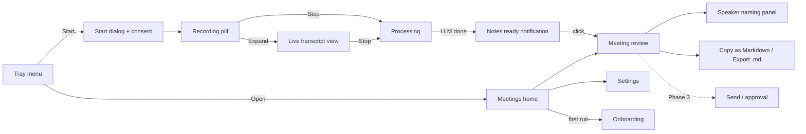

# Modwen: UI Design

Date: 2026-10-16. Companion to [system-design.md](system-design.md). **Clickable HTML mockups of every screen: [mockups/index.html](mockups/index.html)** (open it in a browser; it works offline).

## 1. Is it only a React web app?

**No. There is one React codebase with two thin shells.** You never need a browser tab open to record.

| Part | What it is | MVP (Phase 2) | v1 (Phase 3) |
|---|---|---|---|
| **Tray / menu-bar icon** | Native OS menu: start, stop, status | `pystray` (Python) | Tauri tray |
| **Recording pill** | A small floating window while recording: timer, levels, stop | Browser mini-window (`/pill` route) | Tauri always-on-top window, same React route |
| **Main window** | Meetings, live transcript, review, settings (email approval in Phase 3) | React app at `http://127.0.0.1:8765`, opened in your default browser | **Same React app** inside a Tauri desktop window (no browser) |
| **Notifications** | **"Notes ready"** as soon as the LLM finishes; "Notes failed, retry" | `desktop-notifier` (Windows toast, macOS Notification Center) | Tauri native notifications |

Why it's built this way:
- **React is the whole UI.** Every screen is written once and runs in both shells. Moving to Tauri in v1 changes how the window is opened, not the screens.
- **The tray icon gives one-click start/stop** without opening any window. The pill means the main window can stay closed during a meeting.
- **It isn't a hosted web app.** The UI is served only on `127.0.0.1` by the local Modwen service, and nothing is online.

**UI stack:**
- React 18 + TypeScript + Vite.
- Tailwind CSS, using logical properties (`ms-`, `me-`, `ps-`) so RTL works automatically.
- **shadcn/ui** (Radix primitives) for accessible components, which support RTL.
- TanStack Query for REST calls, plus a WebSocket hook for the live transcript.
- React Router.
- `i18next` for UI strings in English and Arabic.
- IBM Plex Sans Arabic + Inter as fonts.

---

## 2. Screen map



Main window navigation (left sidebar): **Meetings · People & voices · Settings**. A **Start meeting** button is always visible at the top.

---

## 3. Screens

The wireframes show layout, not final visuals.

### 3.1 Tray / menu-bar menu

```
 ●  Modwen                        (icon: grey = idle, red = recording,
 ─────────────────────────────        amber = processing, green dot = notes ready)
 ▶  Start meeting          ⌘⇧B
    Start in-person meeting
 ─────────────────────────────
    Notes ready: "Sprint review"  →
 ─────────────────────────────
    Open Modwen
    LLM: local_qwen  ● online
    Settings…
    Quit
```

While recording, the first item becomes **■ Stop meeting (00:23:41)**, and **Pause** is added.

### 3.2 Start dialog + consent

This dialog appears on every Start. It takes a few seconds; Enter accepts the defaults.

```
┌─ Start meeting ───────────────────────────────────────────┐
│ Title      [ Sprint review                    ] (from calendar in v1)
│ Type       (•) Online   ( ) In-person
│ Audio      [✓] My mic: MacBook Mic   [✓] System audio
│ Language   [ Auto (Arabic + English) ▾ ]   options: Auto · English only · Arabic only
│ 🔒 Local only: nothing leaves this computer
│
│ ┌ Consent ───────────────────────────────────────────────┐
│ │ Let participants know they're being recorded.          │
│ │ [ Copy notice EN ]  [ Copy notice AR ]                 │
│ │ [✓] I have informed participants                       │
│ └────────────────────────────────────────────────────────┘
│                                   [ Cancel ]  [ ● Start ] │
└───────────────────────────────────────────────────────────┘
```

- Start is disabled until the consent box is ticked. The box stays ticked for the session, if you choose that in Settings.
- A warning line appears if a Bluetooth mic is selected: "Bluetooth mic lowers accuracy. Use built-in or wired."
- **Language:** keep Auto for mixed meetings. Pick English only or Arabic only when you know the meeting is in one language; it's slightly more accurate and faster.

### 3.3 Recording pill (floating, always on top)

```
┌────────────────────────────────────────────┐
│ ● REC  00:23:41   You ▂▅▇▃  Others ▃▆▂▁   │
│ Local only   [❚❚]  [■ Stop]  [⤢]          │
└────────────────────────────────────────────┘
```

- **Two level meters** show at a glance that both your mic and the system audio are being captured. This catches the most common failure: silence on one channel.
- `⤢` opens the live meeting view. The pill can be dragged and remembers its position.
- If a channel stays silent for 60 s, the pill turns amber: "No system audio for 60 s".

### 3.4 Live transcript view (MVP, kept simple)

```
┌ Sprint review · ● 00:23:41 · Local only ─────────── [❚❚] [■ Stop] ┐
│                                                                   │
│ 00:21:10  You       So the release is Thursday, right?            │
│ 00:21:14  Others    ‏أيوه، بس محتاجين الـ QA يخلص قبلها‏               │
│ 00:21:20  Others    I'll take the regression tests.               │
│ ...  (auto-scroll; live text is lighter grey = draft)             │
│                                                                   │
│ [ + Mark moment ]   ← adds a bookmark the LLM treats as important │
└───────────────────────────────────────────────────────────────────┘
```

- Live labels are only "You / Others". Real names appear after processing.
- It's deliberately simple: one scrolling list, auto-scroll that pauses when you scroll up (with a "Jump to latest" button), and no editing during the meeting.
- For 2+ hour meetings, only the last ~500 lines are kept on screen. The full live text is still available by scrolling up, loaded on demand.
- If the machine can't keep up, a banner says "Live transcript paused, recording continues", and the live view skips ahead.
- **Mark moment** (hotkey `⌘⇧M`) bookmarks a moment. The notes prompt treats bookmarks as important.

### 3.5 Processing

```
┌ Sprint review · processing ─────────────────────────────┐
│ ✓ Audio saved (2h 05m)                                  │
│ ◐ Transcribing (large-v3)          ███████░░░  68%      │
│ ○ Identifying speakers                                  │
│ ○ Writing notes (local_qwen)       part 0 of 9          │
│                                    ~ 14 min left        │
│ You can close this window; you'll get a notification.   │
└─────────────────────────────────────────────────────────┘
```

- On failure, the failed step shows **Retry** and **Switch provider** (for example, a different LLM profile). The transcript is never lost.
- For long meetings, the notes step shows its progress through the chunks ("part 3 of 9"). A retry resumes from the last finished part.

### 3.5a "Notes ready" notification

When the LLM finishes, Modwen sends a native notification: a Windows toast or macOS Notification Center.

```
┌───────────────────────────────────────────┐
│ م Modwen                               │
│ Notes ready: Sprint review (2h 05m)       │
│ 3 decisions · 5 action items              │
│                  [ Open ]  [ Copy notes ] │
└───────────────────────────────────────────┘
```

- **Open** goes to the review screen. **Copy notes** puts the notes on the clipboard as Markdown.
- The tray icon shows a green dot until the notes are opened.
- If generation failed: "Notes failed: Sprint review. The transcript is saved." with a **[ Retry ]** button.

### 3.6 Meetings home

```
┌ Modwen ───────────────────────────────────────────────────────────────┐
│ [● Start meeting]                       [ Search meetings…          ]    │
│──────────┬───────────────────────────────────────────────────────────────│
│ Meetings │  Needs review (2)                                             │
│ People   │  ┌──────────────────────────────────────────────────────────┐ │
│ Settings │  │ Sprint review      Today 10:00 · 58 min · AR/EN · 4 ppl  │ │
│          │  │ ● Notes ready      3 action items         [ Review → ]   │ │
│          │  └──────────────────────────────────────────────────────────┘ │
│          │  Recent                                                       │
│          │  Client call – Acme   Yesterday · Sent to 5 · ✓              │
│          │  1:1 with Sara        Mon · Discarded                         │
└──────────┴───────────────────────────────────────────────────────────────┘
```

- The status chips match the meeting states in system-design §3: Recording, Processing, Notes ready, Failed, Discarded (Sent is added in Phase 3).
- Meetings that need action come first.

### 3.7 Meeting review (the main screen)

This is a two-pane layout: **notes on the left, transcript on the right**, linked both ways.

```
┌ Sprint review · Today 10:00 · 2h 05m ── Summary: [EN● | AR | Both] ── [Regenerate ▾] [Copy ▾] ┐
│ ┌ Notes (editable) ─────────────────────────┐ ┌ Transcript ─────────────── [Search] ┐ │
│ │ Summary                                   │ │ ▶ 00:00 ━━━━━━●━━━━━━━━━ 58:12      │ │
│ │ The team agreed to ship v2.3 on Thursday… │ │                                     │ │
│ │                                           │ │ 00:21:10  You                       │ │
│ │ Decisions                                 │ │ So the release is Thursday, right?  │ │
│ │ • Release v2.3 on Thu 23 Oct  [↗ 00:21:10]│ │                                     │ │
│ │   "الـ release يوم الخميس"                 │ │ 00:21:14  Ahmed  ⓘ voiceprint 0.86  │ │
│ │                                           │ │ ‏أيوه، بس محتاجين الـ QA يخلص قبلها‏    │ │
│ │ Action items                              │ │                                     │ │
│ │ ┌ Owner ──┬ Task ──────────────┬ Due ────┐│ │ 00:21:20  Speaker 3  ⚠ unnamed      │ │
│ │ │ Ahmed ▾ │ Finish QA before   │ 22 Oct ▾││ │ I'll take the regression tests.     │ │
│ │ │         │ release            │         ││ │                                     │ │
│ │ │ ? ▾  ⚠  │ Regression tests   │ —       ││ │ (overlap) ░░ low confidence ░░      │ │
│ │ └─────────┴────────────────────┴─────────┘│ │                                     │ │
│ │ + Add action item                         │ │                                     │ │
│ │                                           │ │                                     │ │
│ │ Open questions                            │ │                                     │ │
│ │ • Who updates the client?    [↗ 00:40:02] │ │                                     │ │
│ └───────────────────────────────────────────┘ └─────────────────────────────────────┘ │
│ ⚠ 1 unnamed speaker · 1 action item without owner          [ Name speakers ]          │
└───────────────────────────────────────────────────────────────────────────────────────┘
```

**Behaviour:**
- **Evidence links.** `↗ 00:21:10` scrolls the transcript to the source lines, highlights them and plays the audio from there. Clicking a transcript line highlights the note items that cite it.
- **Original words.** Under each item, the original quote is shown in its own language, in grey.
- **Everything is editable inline.**
  - Owner is a dropdown of the meeting's people.
  - Due is a date picker. If the deadline was relative, the spoken phrase is shown, e.g. "said: الخميس الجاي".
- **Summary language** defaults to **EN**. Switching to AR or Both generates that version once and caches it.
- **Copy ▾** offers: Copy as Markdown (paste into Gmail, Teams chat, Docs), Copy action items only, Export .md file. In Phase 3 a **Send →** button joins it.
- **Warnings bar** at the bottom: unnamed speakers, action items with no owner, low-confidence items. These never block anything.
- **Regenerate ▾** offers: whole notes, summary only, change summary language, use another LLM profile. Manual edits are kept unless you choose "discard my edits".
- **Transcript editing.** Double-click a line to fix the text. Edited lines get a small ✎ mark.
- **Low-confidence and overlap segments** have a hatched background.

### 3.8 Speaker naming panel (side drawer)

```
┌ Speakers ─────────────────────────────────────────┐
│ You            (mic channel)              ✓       │
│ Ahmed          voiceprint 0.86            ✓ [▶]   │
│ Speaker 3      12 lines · 6 min           [▶]     │
│   Name: [ Sara Haddad          ▾ ]  (from invite) │
│   [✓] Remember this voice (needs Sara's consent)  │
│ Speaker 4      2 lines · 20 s             [▶]     │
│   [ Merge into… ▾ ]   ← fix over-split speakers   │
│                                    [ Apply ]      │
└───────────────────────────────────────────────────┘
```

- `▶` plays a 5-second sample of that speaker.
- **Merge** fixes the common case where one person is split into two speakers.
- Applying updates the transcript and substitutes names in the notes without calling the LLM again.

### 3.9 Send / approval (Phase 3, not in the MVP)

```
┌ Send notes · Sprint review ──────────────────────────────────────────────┐
│ From     you@example.com  (Gmail API)                              │
│ To       [ahmed@example.com ×] [sara@example.com ×] [+]      │
│          [⚠ client@acme.com ×]  External domain, tick to include [ ]     │
│ Subject  [ Meeting notes: Sprint review – 16 Oct 2026            ]       │
│ Language [ Both ▾ ]      Attach transcript [ ] (off by default)          │
│ ┌ Preview ────────────────────────────────────────────────────────────┐  │
│ │ (exact rendered email; English block LTR, Arabic block RTL)        │  │
│ └─────────────────────────────────────────────────────────────────────┘  │
│ ⚠ 1 action item has no owner.                                            │
│                                      [ Back to edit ]  [ Approve & Send ]│
└──────────────────────────────────────────────────────────────────────────┘
```

- Recipients are suggested from people who have an email. They're never taken from LLM output.
- External addresses are highlighted, and each needs a tick to be included.
- **Approve & Send** is the only way an email leaves the machine.
- After sending, a confirmation shows who it went to, with a link to the dispatch log. If sending fails, there is a **Retry** button.

### 3.10 Settings

Tabs: **General · Audio · Transcription · AI model · Notifications · Privacy · About** (Email added in Phase 3)

The **AI model** tab is the visual front end for the `llm` section of `config.yaml`:

```
┌ AI model ─────────────────────────────────────────────────────────┐
│ Active profile   [ local_qwen ▾ ]        ● online · qwen3-8b      │
│                                                                   │
│ Profiles                                                          │
│  local_qwen    http://localhost:8080/v1     local    [Edit][Test] │
│  ollama_qwen   http://localhost:11434/v1    local    [Edit][Test] │
│  [ + Add local profile ]   (only localhost / 127.0.0.1 URLs)      │
│                                                                   │
│ Edit: base_url · model · API key (stored in keychain) ·           │
│       context window · structured output · temperature            │
│ [ Test ] → sends a short bilingual prompt, shows reply + latency  │
└───────────────────────────────────────────────────────────────────┘
```

- **Only local endpoints can be added.** A non-loopback URL is rejected with "Modwen is local-only".
- Every change is written back to `config.yaml`, so the UI and the file never disagree.
- Other tabs:
  - **Audio:** device pickers with a 5-second test meter.
  - **Transcription:** final and live Whisper models, chosen by hardware tier (with an override), plus glossary editing.
  - **Notifications:** turn "Notes ready" on or off, sound on or off.
  - **Email (Phase 3):** Gmail sign-in button, SMTP fields, internal domains.
  - **Privacy:** a "Local only" status (no toggle), retention days, "Delete all data".
  - **General:** timezone shows the OS timezone, used for deadlines, with an optional override.
  - **About:** detected hardware tier (e.g. "Tier C: Apple M2 Pro, 32 GB"), chosen models, version.

### 3.11 People & voices

This is a list of people: name, Arabic name, email, voiceprint status (enrolled date or none).

- **Enroll voice** records 30 s while the person reads a prompt, and requires a consent tick.
- **Delete voiceprint** is always one click.

### 3.12 First-run onboarding (4 steps)

1. **Permissions.**
   - macOS: request mic, system-audio and notification access.
   - Windows: check the mic privacy setting and notification permission.
   - Then run a live meter test for each channel. Playing a test sound checks system-audio capture.
2. **Hardware check.** Show the detected tier (system-design §6.1), the chosen models, and the expected time for a 2-hour meeting. Below the minimum spec, show a clear warning.
3. **AI model check + downloads.**
   - Detect `localhost:8080` and run Test. If nothing is found, show the exact `llama-server` command for this tier.
   - Download the tier's Whisper models, with a progress bar. After that, Modwen works fully offline.
4. **Test notification.** Send a sample "Notes ready" notification so you know it'll reach you.

---

## 4. Arabic and RTL rules

- **UI language** is English or Arabic, switchable in Settings. Arabic flips the whole layout (`<html dir="rtl">`), and Tailwind logical properties handle the mirroring.
- **Content direction is per paragraph, not per page.** Every transcript line and note item uses `dir="auto"`, so an Arabic line reads right-to-left even inside the English UI.
- **Mixed lines** (Arabic with English terms) are wrapped in `<bdi>`, so English words and numbers don't scramble the Arabic word order.
- **Timestamps, durations and times** always stay left-to-right (`dir="ltr"`), even in the Arabic UI.
- **Fonts:** IBM Plex Sans Arabic for Arabic and Inter for Latin, in one font stack so mixed lines match visually. Line height is 1.6 for Arabic readability.
- **Numbers:** Western digits (0–9) by default, with an option for Arabic-Indic digits (٠–٩) in Arabic summaries.

## 5. Visual style

- Calm and dense, like a productivity tool, not a dashboard. Neutral greys with **one accent colour (blue)**.
- Status colours are used only for meaning: red = recording, amber = warning or processing, green = done or sent.
- Light and dark themes follow the OS setting.
- Speaker colours come from a fixed palette of 8 colours, the same speaker always getting the same colour within a meeting. "You" is always the accent blue.
- No modals during review except Send. Speaker naming uses a drawer, so the transcript stays visible.

## 6. Keyboard shortcuts

| Action | Shortcut |
|---|---|
| Start / stop meeting (global) | `⌘⇧B` / `Ctrl+Shift+B` |
| Mark moment (global, while recording) | `⌘⇧M` / `Ctrl+Shift+M` |
| Play / pause audio in review | `Space` |
| Jump to next warning | `⌘J` |
| Copy notes as Markdown | `⌘⇧C` / `Ctrl+Shift+C` |

## 7. Accessibility

- All controls are reachable by keyboard; Radix provides focus management.
- Meters and status are never shown by colour alone; each also has a text label.
- Recording state is announced to screen readers.
- Minimum text size is 13 px; transcript text is 15 px.

## 8. Build order (fits the Phase 2 MVP)

1. Meetings home + Meeting review (read-only), on real processed meetings.
2. Start dialog + recording pill + tray menu (Windows and macOS).
3. Simple live transcript view.
4. Processing screen + "Notes ready" notification.
5. Inline editing + speaker naming drawer + Copy / Export.
6. Settings → AI model tab (profile switch + Test), then the other tabs.
7. Onboarding.

The Send / approval screen and the move to a Tauri window come in Phase 3.
